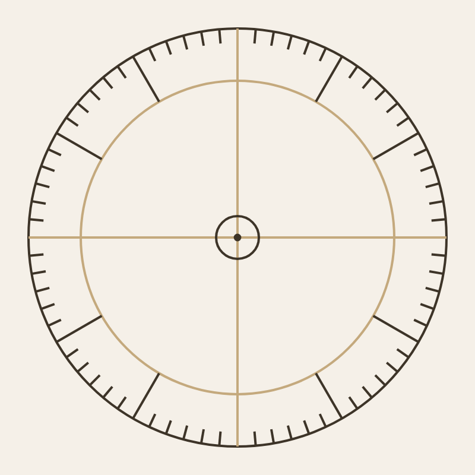
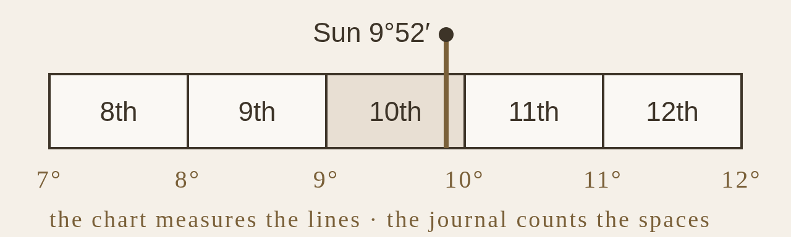
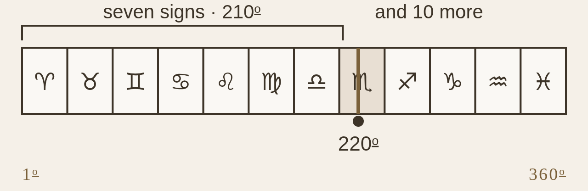
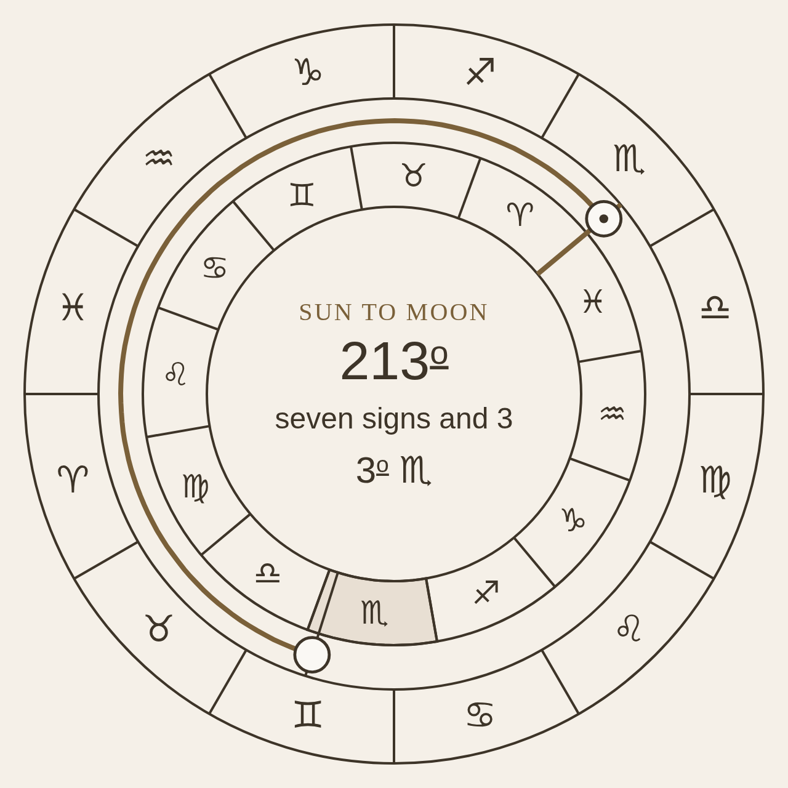

# Notation

**Working decisions awaiting Ana's confirmation.** Worked out on 2026-11-14 by Ana and her husband, who develops the system with her. These rules are the backbone of the Living Year, so none is final until Ana confirms it.

## The example

Ana's birth, used at her request.

| | |
|---|---|
| Train time | 2 November 1974, 10:34 am |
| Place | 52°27′ N · 109°10′ W |
| Chart | Sun 9°52′ ♏, Moon 12°32′ ♊ |
| Journal | Sun 10º ♏, Moon 13º ♊ |
| Date | 5868 · 10º ♏ |
| Quarter | Autumn |
| Solar times (UTC−6) | sunrise 8:14, solar noon 1:00, sunset 5:46 |

Solar noon fell a whole hour after clock noon.

## 1. The era is Anno Mundi

AM = 3894 + CE year. The AM year turns at the Aries ingress. 2026 CE is 5920 AM. 1974 CE is 5868 AM. The era is written "Anno Mundi".

## 2. Degrees are counted ordinally

The journal counts 1º to 30º in each sign and 1º to 360º in the year. There is no 0º. The ordinal mark º (U+00BA) is drawn as a small circle resting on a short bar. It must never be confused with the cardinal degree sign ° (U+00B0), which is used only for chart values and coordinates.

## 3. Number before sign

Write 10º ♏, spoken "the 10th of Scorpio". With the year: 5868 · 10º ♏.

## 4. From a chart to the journal

Charts measure from zero. Leave the minutes and add one. 9°52′ ♏ becomes 10º ♏. A chart's 0° is the journal's 1º.

"The chart measures the lines; the journal counts the spaces."

Example: Sun 9°52′ ♏ becomes 10º ♏. Moon 12°32′ ♊ becomes 13º ♊.

## 5. Place in the year

One sign is 30º and the twelve make 360º. Take where the sign before ends and add the degree. Libra ends at 210º, so 10º ♏ is 210 and 10, the 220th degree. The Moon at 13º ♊: Taurus ends at 60º, and 13 more is 73º.

| Sign | Range | Sign | Range |
|---|---|---|---|
| Aries ♈ | 1º–30º | Libra ♎ | 181º–210º |
| Taurus ♉ | 31º–60º | Scorpio ♏ | 211º–240º |
| Gemini ♊ | 61º–90º | Sagittarius ♐ | 241º–270º |
| Cancer ♋ | 91º–120º | Capricorn ♑ | 271º–300º |
| Leo ♌ | 121º–150º | Aquarius ♒ | 301º–330º |
| Virgo ♍ | 151º–180º | Pisces ♓ | 331º–360º |

## 6. The Moon's phase, two ways

The two ways give the same answer.

- **(a) By subtraction.** Moon minus Sun. Below zero, add 360. Example: 73 − 220 is below zero, so add 360: 213º.
- **(b) Around the circle.** Count the signs from the Sun on to the Moon, 30º each, then the remaining degrees. Example: from 10º ♏ to 10º ♊ is seven signs, 210º, and three further: 213º.

By the eight phases, 213º is full.

## 7. The lunation as a zodiac

The Moon's distance from the Sun is itself a circle of 360º, so the twelve signs can name it. A new Moon is 1º ♈ of the lunation. Example: 213º is seven signs and 3, so the Moon stands at the 3rd of Scorpio, 3º ♏, of the lunation.

This sits beside the eight phases, which come from Dane Rudhyar's *The Lunation Cycle* (1967):

| Phase | Range |
|---|---|
| New | 1º–45º |
| Crescent | 46º–90º |
| First quarter | 91º–135º |
| Gibbous | 136º–180º |
| Full | 181º–225º |
| Disseminating | 226º–270º |
| Last quarter | 271º–315º |
| Balsamic | 316º–360º |

The twelve-sign reading is Ana and her husband's own extension. No source was found for it, and none is claimed. See [research/rudhyar-and-the-lunation.md](research/rudhyar-and-the-lunation.md).

Eight small icons of the phases are in [notebook/images/](notebook/images/): `phase-1-new` to `phase-8-balsamic`.

## 8. Quarters

| Quarter | Range | Stage |
|---|---|---|
| Spring | 1º–90º | albedo |
| Summer | 91º–180º | citrinitas |
| Autumn | 181º–270º | rubedo |
| Winter | 271º–360º | nigredo |

Example: 220º falls in Autumn. The mapping of the fourfold work onto the quarters is Ana's.

## 9. What an entry records

- Sun
- Moon and phase
- Year
- Place (latitude and longitude)
- Solar time (sunrise, solar noon, sunset, looked up)
- Quarter
- Train time (the calendar date, small)

People write when they have something to record. "This is not a day planner."

## Unchecked aside

Laying the same 213º from the Ascendant (chart: 3°17′ ♐) gives about 6º ♋. Rudhyar's tradition calls that point the Part of Fortune. This is an unchecked sum.
