# The Solar Journal: A First Notebook

**Draft. "A First Notebook" is a working title.** The page-by-page text below follows the HTML source, [first-notebook.html](first-notebook.html), which is the source of truth for wording.

The notebook is a small workshop handout: a cover, how an entry begins, one entry filled in as an example, that example drawn, two blank entries, and the keys. In print each page would be A5, like the journal. The example is a birth entry taken from a chart for 2 November 1974. The blank birth page that follows it is for the reader's own.

---

## Cover

The Living Year

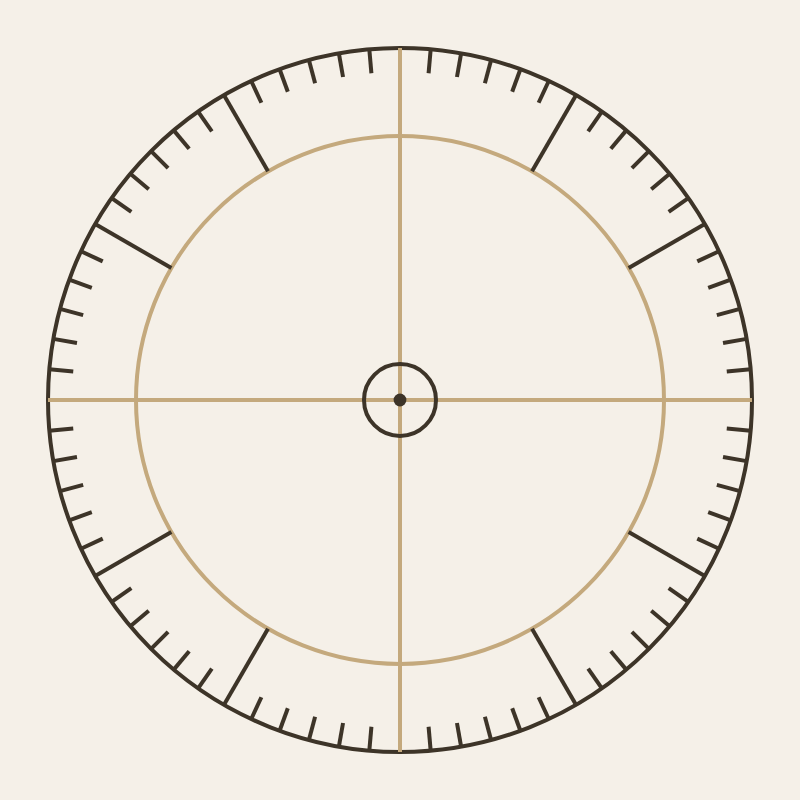

**The Solar Journal**
A First Notebook

*The calendar names it. The sky locates it.*

---

## Page one: How an entry begins

Write when there is something to record. Each entry opens by saying where it was written: in the year, under the Moon, and on the Earth.

1. **The Sun.** Its sign and degree. This is the date. The year begins at 1º ♈.
2. **The Moon.** Its sign and degree, then its phase.
3. **The year.** Anno Mundi, the common year, or both.
4. **The place.** Latitude and longitude. Written once, and again after a move.
5. **Solar time.** Sunrise, noon and sunset for that place, looked up. Solar noon and clock noon are rarely the same moment.
6. **The quarter.** Spring, Summer, Autumn or Winter.
7. **Train time.** The calendar date, small, for meeting the world.

Then write. A line is an entry. A page is an entry.

> **From a chart to the journal.** Charts and almanacs measure from zero: 9°52′ ♏. The journal counts the way a calendar does, first, second, third. Leave the minutes and add one: 9°52′ is in the 10th degree, written 10º ♏. A chart's 0° is the journal's 1º.

---

## Page two: An example, a birth

**5868 · 10º ♏**

| | |
|---|---|
| Sun | 10º ♏ |
| Moon | 13º ♊ · full |
| Year | 5868 · 1974 |
| Quarter | Autumn |
| Place | 52°27′ N · 109°10′ W |
| Train time | 2 November · 10:34 am |
| Sunrise | 8:14 |
| Solar noon | 1:00 |
| Sunset | 5:46 |

*Born on a prairie morning under a full Moon. That day the Sun stood highest a whole hour after the clock said noon.*

**From the chart**

- Sun 9°52′ ♏ becomes **10º ♏**
- Moon 12°32′ ♊ becomes **13º ♊**

**Finding the phase**

- Sun: ♎ ends at 210º, and 10 more: **220º**
- Moon: ♉ ends at 60º, and 13 more: **73º**
- Moon − Sun: 73 − 220 falls below zero, so add 360: **213º**, which is full.

**Or around the circle**

- Count the signs from the Sun on to the Moon. From 10º ♏ to 10º ♊ is seven signs: **210º**
- The Moon is at 13º, three further: **213º**, full.

---

## Page three: The example, drawn

### From the chart to the journal

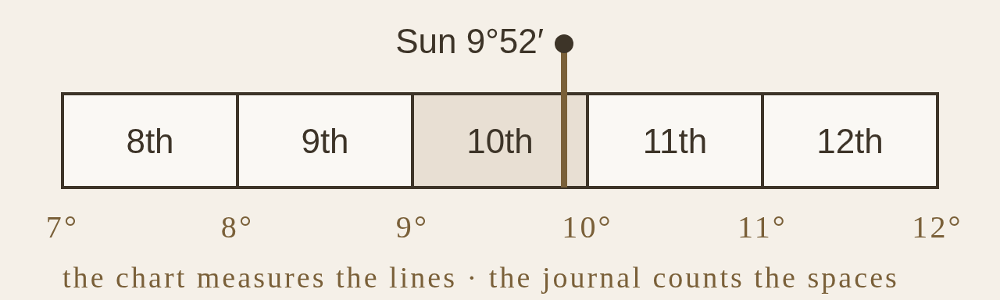

The chart's 9°52′ ♏ lies past the 9° line, inside the tenth space. The journal names the space: **10º ♏**.

### The place in the year

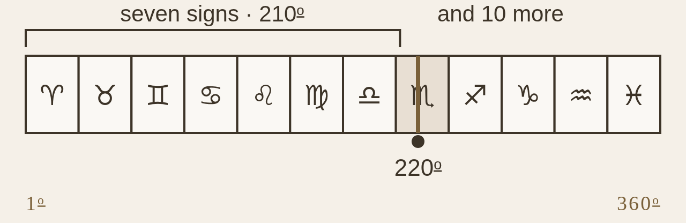

Seven signs lie before ♏, and ♎ ends at 210º. Ten more is the **220th degree** of the year.

---

## Page four: The example, drawn

### From the Sun on to the Moon

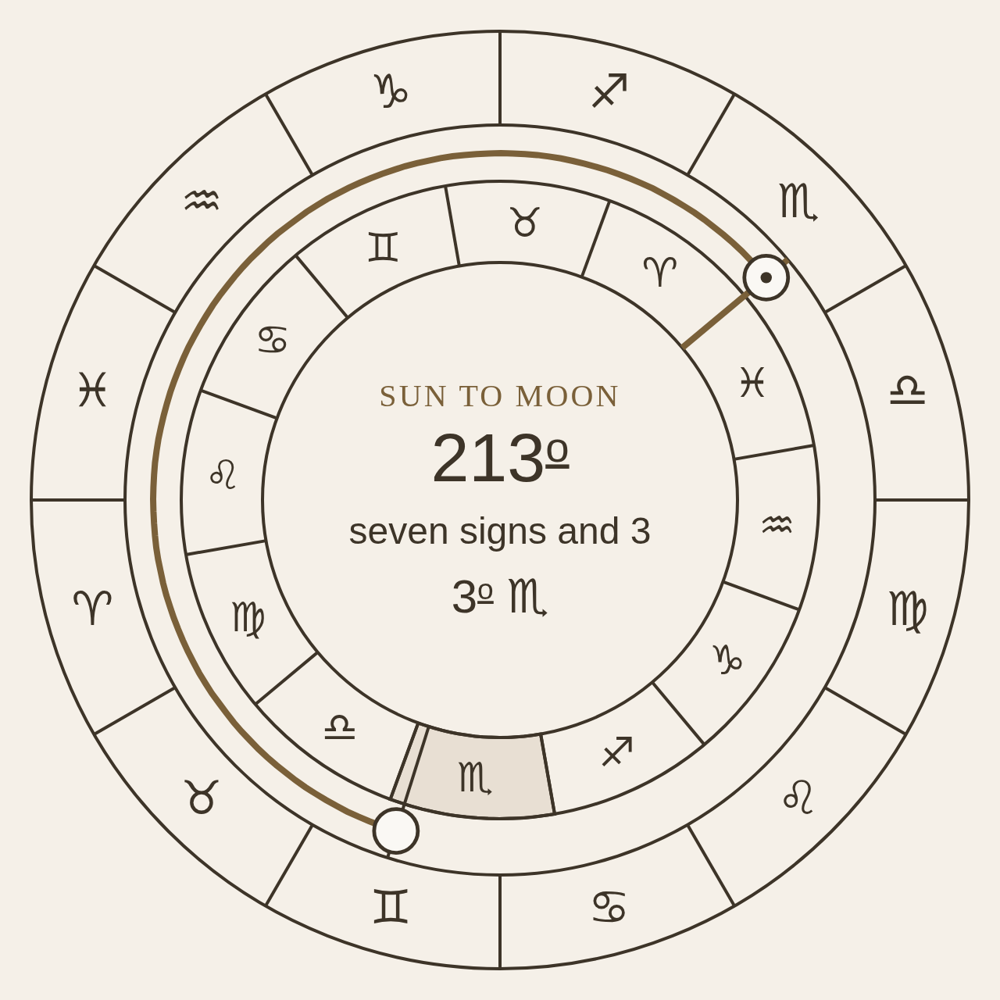

The outer ring is the sky: the Sun at 10º ♏, the Moon at 13º ♊. The inner ring is the same zodiac begun again at the Sun, where every lunation starts. The Moon stands in its Scorpio, three degrees in: **3º ♏ of the lunation.**

> The same by numbers: Moon 73º, Sun 220º. 73 − 220 falls below zero, so add 360: 213º.

A new Moon is 1º ♈ of the lunation. By the eight phases, 213º is a full Moon.

---

## Page five: A first entry

A blank entry, typeable in the HTML version. Fields: Sun, Moon, Year, Quarter, Place, Train time, Sunrise, Solar noon, Sunset, then ruled lines headed "Entry".

---

## Page six: Where the year began for you

A blank page with two parts. Fields: Birth degree, Birth Moon.

Each year the Sun returns to the degree it held at birth. That return is a personal new year, and a good day for an entry.

Then "A second entry": Sun, Moon, Sunrise, Solar noon, Sunset, and ruled lines headed "Entry".

---

## Page seven: The keys

### The signs

| Sign | Range | Sign | Range |
|---|---|---|---|
| ♈ Aries | 1º–30º | ♎ Libra | 181º–210º |
| ♉ Taurus | 31º–60º | ♏ Scorpio | 211º–240º |
| ♊ Gemini | 61º–90º | ♐ Sagittarius | 241º–270º |
| ♋ Cancer | 91º–120º | ♑ Capricorn | 271º–300º |
| ♌ Leo | 121º–150º | ♒ Aquarius | 301º–330º |
| ♍ Virgo | 151º–180º | ♓ Pisces | 331º–360º |

One sign is 30º, and the twelve make 360º. To place a day in the whole year, take where the sign before it ends and add the degree: 10º ♏ is 210 and 10, the 220th degree. Moon minus Sun gives the phase. Below zero, add 360. Or count the signs around the circle from the Sun on to the Moon, 30º for each.

### The eight phases

| | | | |
|---|---|---|---|
| 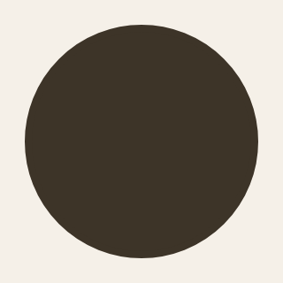 **New** 1º–45º | 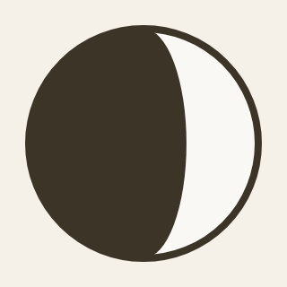 **Crescent** 46º–90º | 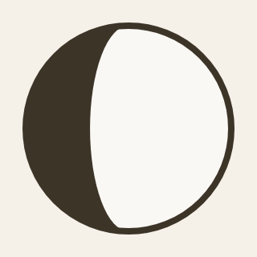 **First quarter** 91º–135º | 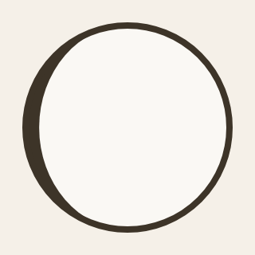 **Gibbous** 136º–180º |
| 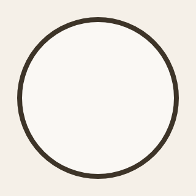 **Full** 181º–225º | 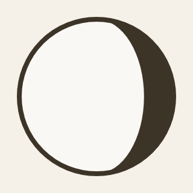 **Disseminating** 226º–270º | 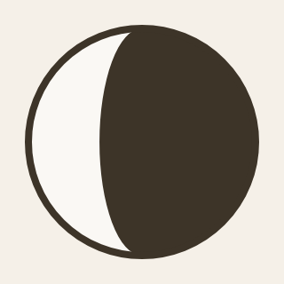 **Last quarter** 271º–315º | 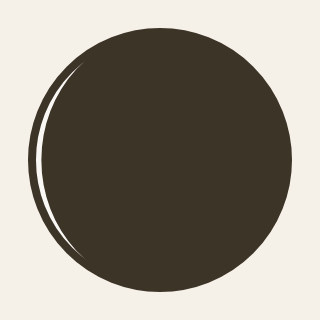 **Balsamic** 316º–360º |

### The four quarters

| Quarter | Range | Stage |
|---|---|---|
| Spring | 1º–90º | albedo |
| Summer | 91º–180º | citrinitas |
| Autumn | 181º–270º | rubedo |
| Winter | 271º–360º | nigredo |
